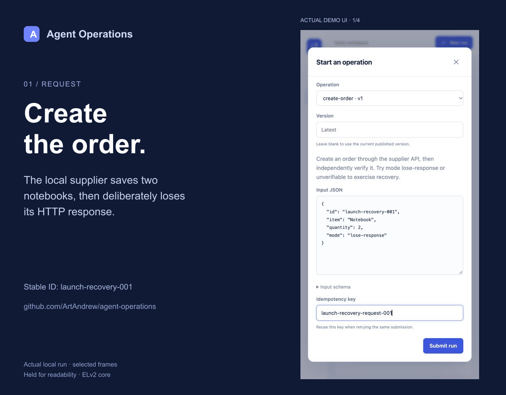

# Agent Operations

**An agent sent the order. The response disappeared. What happens next?**

Agent Operations records API and browser actions, checks what actually happened after a failure, and pauses for human review when it cannot establish the result.

[](https://github.com/ArtAndrew/agent-operations/actions/workflows/ci.yml)
[](https://github.com/ArtAndrew/agent-operations/releases)
[](LICENSE)

[Quickstart](#try-it-locally) · [Integration examples](examples/integrations/README.md) · [How recovery works](docs/articles/lost-response.md) · [First-run feedback](https://github.com/ArtAndrew/agent-operations/issues/new?template=first-run.yml)

An operation can call an API, use a browser, request structured model output, or transform data. Agent Operations records each step, separates a dispatched action from a confirmed result, and makes uncertain writes visible for reconciliation.

The server and dashboard are source-available under [Elastic License 2.0](LICENSE). The independently usable [TypeScript](sdk/typescript) and [Python](sdk/python) clients are Apache-2.0.



These selected frames from a real local run are held for readability. The supplier fixture persists an order, intentionally drops the response, and exposes a separate lookup endpoint. It makes no real purchase and uses no paid model. [Reproduce it yourself](docs/quickstart.md).

## Try it locally

Requires Node.js 22.12 or later and pnpm 11.25.0.

```sh
git clone https://github.com/ArtAndrew/agent-operations.git
cd agent-operations
corepack enable
pnpm install --frozen-lockfile
pnpm exec playwright install chromium --only-shell
pnpm demo
```

Open **http://127.0.0.1:4300** and choose **Enter demo workspace**. The supplier portal runs at **http://127.0.0.1:4301**.

The demo stores orders on disk and uses a deterministic model fixture. It does not contact a paid model or place external orders.

Try these operations:

| Operation        | What happens                                                                                             |
| ---------------- | -------------------------------------------------------------------------------------------------------- |
| `create-order`   | Calls the supplier API and verifies the stored order independently.                                      |
| `reviewed-order` | Produces structured demo analysis, waits for a human decision, then creates the order.                   |
| `browser-order`  | Fills a supplier form in an isolated browser, captures a receipt screenshot and verifies the API result. |

Example input:

```json
{ "id": "order-1001", "item": "Notebook", "quantity": 2, "mode": "normal" }
```

For `create-order`, change `mode` to `lose-response` to commit the order but lose the response. The worker checks the external result and completes without sending the write again. Use `unverifiable` to simulate an unavailable verification endpoint. Restore it in the supplier portal, then choose **Check again** on the run.

For the exact released source, run `git checkout v0.1.0` after cloning. [GitHub Release](https://github.com/ArtAndrew/agent-operations/releases/tag/v0.1.0) also provides Linux Docker images and installable Python/TypeScript SDK archives. See [prebuilt installation](docs/prebuilt.md).

## Use it with your existing agent

| Example                                                   | What it proves                                                                          | Model key required? |
| --------------------------------------------------------- | --------------------------------------------------------------------------------------- | ------------------- |
| [Python recovery](examples/integrations/recover_order.py) | Lost-response recovery and repeated submission returning the same run                   | No                  |
| [LangGraph](examples/integrations/langgraph_order.py)     | A real graph node submits an operation and routes approval or uncertainty to the caller | No                  |
| [browser-use](examples/integrations/browser_use_order.py) | A registered custom tool requests an approved browser operation                         | No                  |

These examples are tested against pinned libraries. The browser-use example exercises its tool registry and the server's real Chromium operation; it does not claim to test an autonomous model-driven browsing session. [Setup and boundaries](examples/integrations/README.md).

Use Agent Operations when you need an explicit contract around an external action: its business identity, exact approval, verification and recovery. Your existing agent can retain planning and model selection. Operations are currently sequential; see the boundaries below before adopting it.

## What is included

- Immutable operation versions, JSON Schema input contracts and stable request idempotency.
- HTTP, isolated-browser, structured-model and data-transformation steps.
- A business-action ledger shared across runs, with conflicting-payload detection.
- PostgreSQL leases, worker heartbeats, durable state and recovery after a worker stops.
- Approvals tied to the resolved action digest; optional separation by API-key identity.
- Read-only reconciliation and evidence-backed manual exception resolution.
- Workspace isolation, roles, encrypted connector secrets, daily run limits and concurrency limits.
- A dashboard for runs, definitions, approvals, connections, usage, keys and audit records.
- Local or S3-compatible artifact storage, including browser receipt screenshots.
- TypeScript and dependency-free Python SDKs.
- A local embedded PostgreSQL mode and a network PostgreSQL mode for multiple processes.

Agent Operations does **not** promise universal exactly-once delivery to third-party services. A network timeout cannot reveal whether a remote write committed. [Execution semantics](docs/execution.md) explains what the engine can prove, when it will retry and when it requires evidence.

## Connect your own agents

An agent built with your preferred framework can submit a named operation through the SDK or REST API. The operation owns the external action, approval and verification contract. Existing agents can continue planning and interpreting results outside this server.

```ts
import { AgentOperations } from "./sdk/typescript/dist/index.js";

const client = new AgentOperations({
  baseUrl: "http://127.0.0.1:4300",
  apiKey: process.env.AGENT_OPERATIONS_API_KEY!,
});

const { run } = await client.submit(
  "create-order",
  { id: "order-1001", item: "Notebook", quantity: 2 },
  { idempotencyKey: "purchase-request-1001" },
);
const result = await client.wait(run.id);
console.log(result.run.status, result.run.outputs);
```

`wait` returns when a run finishes **or** needs a human decision. Timing out or stopping the client does not cancel the server-side operation.

## Run without demo data

```sh
cp .env.example .env
pnpm build
pnpm cli serve
```

Retrieve the local platform token with `pnpm cli token`. Sign in to create a workspace, then save its initial workspace key. Alternatively, run `pnpm cli workspace "My team"`. Locally generated secrets live in `.data/local-secrets.json`; this directory is ignored by Git.

Before creating external connections, configure their exact origins in `ALLOWED_ORIGINS`. Private destinations and plain HTTP require explicit development configuration. Never use the demo login on a publicly accessible deployment.

## Documentation

- [Ten-minute first-run walkthrough](docs/quickstart.md)
- [Prebuilt Docker images and SDK archives](docs/prebuilt.md)
- [Why retrying an agent action can duplicate an order](docs/articles/lost-response.md)
- [Bind approval to the action that will execute](docs/articles/exact-approval.md)
- [Verify browser actions after a failure](docs/articles/browser-verification.md)
- [Operation definitions and examples](docs/operations.md)
- [Execution, retries and recovery](docs/execution.md)
- [Deployment and configuration](docs/deployment.md)
- [REST API and access roles](docs/api.md)
- [Security boundaries](SECURITY.md)
- [TypeScript SDK](sdk/typescript/README.md) and [Python SDK](sdk/python/README.md)
- [Licensing](docs/licensing.md) and [third-party notices](THIRD_PARTY_NOTICES.md)

## Development and verification

```sh
pnpm typecheck
pnpm test
pnpm build
pnpm test:browser
pnpm test:e2e
```

Set `TEST_DATABASE_URL` to run the integration suite against PostgreSQL instead of embedded PostgreSQL. Tests create and remove isolated schemas. Browser tests require the Playwright Chromium installation.

The test suite exercises lost responses after commit, expired leases, duplicate business actions, approval binding, input validation, tenant isolation, credential handling, both SDKs and browser workflows. See [contributing](CONTRIBUTING.md) for development conventions.

## Current boundaries

Operations are ordered step sequences. Arbitrary Python or shell code is not executed inside the server. Browser recipes use explicit selectors and actions; the built-in model step produces schema-validated JSON and does not autonomously invoke tools. External agent frameworks can choose and submit operations through the SDK.

The current release does not include SSO, a payment processor, a visual workflow builder, multi-region coordination or a hosted service. Production deployments need their own TLS, backups, network isolation, monitoring and capacity validation.

## Try one workflow and tell us what happened

We are looking for early users who operate agents that change external systems. Run one demo, then [share a first-run report](https://github.com/ArtAndrew/agent-operations/issues/new?template=first-run.yml): what you tried, where you got stuck, and which real action you want to protect. Redact credentials and customer data. [Questions and use cases](https://github.com/ArtAndrew/agent-operations/discussions) are welcome.

There is no adoption or production-performance claim in this release. Feedback from an independent installation is more useful than a synthetic benchmark alone.
